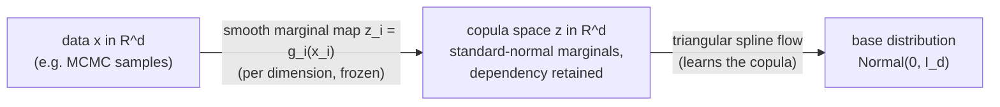

<p align="center">
  
</p>

<h1 align="center">coppuccino</h1>

<p align="center">
  <em>Density estimation for multivariate data with copula normalizing flows, in JAX.</em>
</p>

<p align="center">
  <a href="https://github.com/AaronDJohnson/coppuccino/actions/workflows/test.yml"></a>
  
  
</p>

---

**coppuccino** fits and samples from complex multivariate probability
distributions by combining two classical ideas: *copulas*, which separate a
joint distribution into its one-dimensional marginals and a dependency
structure, and *normalizing flows*, which learn that dependency structure
flexibly. It is designed for — though not limited to — density estimation on
**MCMC posterior samples**, where it enables fast resampling, density
evaluation, importance weighting, and calibration diagnostics.

## The idea

Any continuous joint distribution can be decomposed into its marginals and a
*copula* that couples them. This is **Sklar's theorem**: for a joint density
$p(\mathbf{x})$ on $\mathbb{R}^d$ with marginal CDFs $F_i$ and marginal
densities $p_i$,

$$
p(\mathbf{x}) = \underbrace{c\big(F_1(x_1), \dots, F_d(x_d)\big)}_{\text{copula density}} \prod_{i=1}^{d} \underbrace{p_i(x_i)}_{\text{marginals}}.
$$

The copula density $c$ captures *all* of the dependence between dimensions; the
$p_i$ capture the shape of each dimension on its own. Estimating these two
pieces separately is often much easier than estimating $p(\mathbf{x})$
directly — especially when the marginals are sharp, bounded, skewed, or
multimodal, which tends to defeat a plain normalizing flow.

coppuccino estimates the marginals **nonparametrically** and the copula with a
**normalizing flow**.

## How it works

Fitting proceeds in two stages. Each marginal is mapped to Gaussian space by
a clip-free monotone transform, and the copula is learned there by a
triangular spline flow over a standard-normal base.



**1. Marginal transforms.** Each dimension is mapped onto the real line by its
own monotone map $z_i = g_i(x_i)$, built from the data quantiles as a
**rational-quadratic spline bulk joined to analytic tails** (see
[Marginal transforms](#marginal-transforms)). The map is a single
parameterization — forward map, inverse and log-derivative all read the same
knots — and it carries all of $\mathbb{R}$ onto the support, so every finite
$z$ lands strictly inside the prior and no clipping is involved.
After this step $\mathbf{z}$ has standard-normal marginals while retaining the
full dependency structure: by Sklar's theorem, what is left to model *is* the
copula. These transforms are estimated once and then frozen.

**2. The copula flow.** A triangular spline flow
([flowjax](https://github.com/danielward27/flowjax)) models the density of
$\mathbf{z}$ against a standard-normal base. Each layer pairs a triangular
affine map — which represents linear correlation exactly, and is why this
pipeline suits strongly correlated posteriors — with elementwise
rational-quadratic splines for the non-Gaussian part. Only this stage is
trained.

The log-density of a point is available in closed form,

$$
\log p(\mathbf{x}) = \log q(\mathbf{z}) + \sum_{i=1}^{d} \log g_i'(x_i),
$$

where $\log q$ is supplied by the flow and $g_i'$ are the marginal
log-derivatives. **Sampling** runs the pipeline in reverse: draw $\mathbf{z}$
from the copula flow and invert the marginals with $x_i = g_i^{-1}(z_i)$.

Boundary behavior is the reason the marginal map is built this way. When a
fitted flow is used as an independence MCMC proposal, a proposal that draws
from true density $s$ but reports density $q$ has stationary law
$\pi\, s/q$, so any mismatch at a hard support boundary becomes an
exponentially amplified bias. The smooth marginal removes that at the root:
samples land strictly inside the prior, the reported density is the density of
the stream `sample` actually emits — one parameterization serves the forward
map, the inverse and the log-derivative — and out-of-data queries get honest
tail values (`tail_alpha` selects Gaussian or heavier tails for outlier
tolerance). What it does *not* give you is a faithful pointwise density on a
bound itself; that is the next paragraph.

The density **at** a bound is the one thing this family does not model
faithfully, and the error is upward. The bounded marginal saturates a short way
outside its outermost knot rather than running all the way to $z = \pm\infty$,
so every query in the thin sliver next to a wall maps to the same $z$ and
receives the same density — the density of the last resolved interval, not of
the wall.

Measured on $U[0,1]^2$ with `prior_bounds=[[0,1],[0,1]]` (1500 rows drawn from
`np.random.default_rng(s)`, `max_epochs=80`, `rng_seed=s`, $s = 0\ldots3$, true
log-density 0 everywhere), probing $[x, 0.5]$ at both walls on the decade set
$x \in \{0.5, 10^{-k}, 1-10^{-k}\}$: `log_prob` runs
−1.11 to +1.32 nats from the centre out to $10^{-2}$ from a wall, −2.11 to +1.85
at $10^{-4}$, +0.38 to +4.44 at $10^{-6}$, and **+0.53 to +4.52 exactly on a
bound** — the value at $10^{-9}$ being bitwise identical to the value on the
bound, which is the saturation sliver. On a chain that genuinely has mass sitting
on a wall the excess is much larger: on 1500×2 `clip(N(0.77, 0.25), -1, 1)` in a
$\pm1$ box (460–500 of 1500 rows touching a bound, same fit settings, seeds 0–3)
the median at-bound `log_prob` is +8.46 to +13.35 against an interior median of
+0.29 to +0.50, an excess of +8.17 to +12.87 nats, because the wall density there is the
atom's mass spread over the outermost inset interval. This is
self-consistent — the sampler and `log_prob` come from one parameterization —
but it is not a pointwise density you should read off. Prefer
`sample_and_log_prob` over evaluating `log_prob` on the walls themselves, and
see `SmoothMarginalToGaussian` for the mechanism.

> **At a wall itself** the Gaussian pipeline is not the most accurate choice:
> on the $U[0,1]^2$ fit above it reports +0.53 to +4.52 nats on the bound where
> the unit-cube marginals of `normalizing_flows_fit_fleet` report −2.36 to
> +1.47 on the same data and the same seeds (truth 0). If the density on the
> boundary is the quantity you need — weakly-constrained, flat-to-the-wall
> marginals — fit with `normalizing_flows_fit_fleet`; a one-source fleet is a
> legitimate way to use it.

### Why this design

- **Separation of concerns.** The flow spends all of its capacity on
  dependency, because the marginals are already standard normal. The
  empirical marginal maps, in turn, reproduce difficult marginal shapes
  (bounded, spiky, heavy-tailed, multimodal) that flows struggle to fit on
  their own.
- **Honest density and importance weights.** The marginal transforms and the
  copula flow are closed-form bijections that share one set of knots between
  forward map, inverse and derivative, so `sample` and `log_prob` describe the
  same object and `sample_and_log_prob` weights are honest by construction.
  Round-tripping the data — $x \to z \to x$ over every distinct training value —
  is exact to float64: $\le 5\times10^{-16}$ on 1500×2 fits (80 epochs, seed 0)
  of a chain that stays inside its box, a chain with about a third of its rows
  clipped onto a wall, and an unbounded chain alike, for every value strictly
  inside the support. A training value sitting *exactly* on a bound is the
  exception: it comes back displaced inward by the wall inset, $10^{-6}$ on the
  wall-atom fit above. Round-tripping *deep Gaussian space* inside a bounded box
  has a hard limit, because the bounded marginal saturates rather than running
  to infinity. Sweeping $z \to x \to z$ over 2001 points on $[-8, 8]$: both
  bounded fits saturate at $|z| \approx 4.90$, and below that the worst absolute
  error stays under $10^{-10}$; above it $x$ no longer moves, so $z$ does not
  come back.
  The cap is derived from the marginal's own knots, so it moves with the data;
  at the $\approx 4.90$ measured here a standard normal puts about $10^{-6}$ of
  its mass beyond it, and `sample`/`sample_and_log_prob` redraw those rows. With no
  `prior_bounds` there is no wall and no cap: the same sweep round-trips to
  $2\times10^{-15}$ at every $z$ in $[-8, 8]$.
- **Built for bounded posteriors.** With `prior_bounds` — the common situation
  for MCMC chains — the fitted support is exactly the prior box: draws land
  strictly inside it with no atoms on the walls, and `log_prob` returns `-inf`
  outside it, so `np.isfinite(log_prob(flow, x))` is a support test. Inside the
  box the density is strictly positive in float64 all the way to the walls: on
  2000×2 `N(0,1)` data from `default_rng(s)` with `prior_bounds` at ±10 and ±50
  (`max_epochs=200`, `rng_seed=s`, $s = 0\ldots2$, both corners)
  `exp(log_prob)` at the corner runs
  $10^{-10}$…$4\times10^{-5}$ and $5\times10^{-13}$…$2\times10^{-7}$ — small,
  but hundreds of orders of magnitude above float64 underflow. The flip side is
  that a *wide* box over-reports in its empty region rather than
  under-reporting: the true standard-normal log-density at those corners is
  −101.8 and −2501.8 while the fit reports −23.0 to −10.1 and −28.4 to −15.4.
  `log_prob` is a support test, not
  an outlier detector, once the box is much wider than the data. See the
  boundary discussion above for the numbers at the wall itself. Without
  `prior_bounds` each side is treated as unbounded and the marginal extends
  analytic tails past the data,
  so the support is all of $\mathbb{R}^d$.

## Installation

```bash
pip install coppuccino
```

From source:

```bash
git clone https://github.com/AaronDJohnson/coppuccino.git
cd coppuccino
pip install .
```

> **Note:** importing `coppuccino` — or any of its submodules — enables JAX
> 64-bit mode process-wide (`jax.config.update("jax_enable_x64", True)`). The
> marginal transforms and log-determinants rely on float64 accuracy, but the
> setting is global, so JAX arrays created *after* the import default to
> float64 everywhere else in the session too. It can be undone
> (`jax.config.update("jax_enable_x64", False)`, or scoped with
> `jax.experimental.disable_x64()`); coppuccino still runs at float32, with
> reduced precision in the wall and tail logic.

### Development

This project is managed with [uv](https://docs.astral.sh/uv/):

```bash
uv sync           # create the environment and install coppuccino + dev deps
uv run pytest     # run the test suite
```

## Quick start

```python
import numpy as np
from coppuccino import normalizing_flows_fit, sample, log_prob, save_flow, load_flow

# Fit a copula flow to multivariate data (e.g. MCMC posterior samples)
data = np.random.randn(5000, 3)
flow = normalizing_flows_fit(data, max_epochs=200)

# Draw new samples from the fitted distribution
new_samples = sample(flow, n_samples=1000, rng_seed=42)

# Evaluate the log probability density
log_probs = log_prob(flow, new_samples)

# Persist and reload the model
save_flow(flow, "my_flow.pkl")
loaded_flow = load_flow("my_flow.pkl")
```

The [`examples/`](examples/) directory contains a worked, end-to-end notebook —
[`galactic_binary_example.ipynb`](examples/galactic_binary_example.ipynb) — that
fits a flow to a real gravitational-wave posterior and compares the samples to
the original chain, plus an HDR calibration walkthrough in
[`hdr_credibility.ipynb`](examples/hdr_credibility.ipynb).

### Many chains at once: the fleet

When you have one chain per source in a catalog — the same parameters, the same
prior box, hundreds or thousands of sources — fitting them one at a time is the
wrong shape of computation. `normalizing_flows_fit_fleet` stacks the per-source
flows and trains them under a single `vmap`, and the returned `FleetFlow`
samples and scores every source in one batched call.

```python
import numpy as np
from coppuccino import normalizing_flows_fit_fleet, FleetFlow

# One chain per source: (n_sources, n_samples, n_params), all sharing a box.
chains = np.random.randn(64, 4000, 3) * 0.4
prior_bounds = np.array([[-3.0, 3.0], [-3.0, 3.0], [-3.0, 3.0]])

fleet = normalizing_flows_fit_fleet(chains, prior_bounds, max_epochs=200)

draws = fleet.sample(500, rng_seed=0)     # (64, 500, 3) — every source at once
log_probs = fleet.log_prob(draws)         # (64, 500)

# One source, same seed, same draws as the batched call.
one = fleet.sample(500, rng_seed=0, source_index=7)   # (500, 3) == draws[7]

fleet.save("fleet.pkl")
fleet = FleetFlow.load("fleet.pkl")
```

The fleet is a **different model** from `normalizing_flows_fit`, not a batched
wrapper around it: it builds clipped rational-quadratic marginals onto the unit
cube and learns the copula there over a uniform base, where the single-flow path
Gaussianizes. That is why it is the better choice at a hard wall (see
[How it works](#how-it-works)) and why it takes `batch_size`/`val_prop` instead
of `tail_alpha`. Its input contract is also stricter than
the single-flow one, deliberately: `prior_bounds` must be finite and ordered on
every row, `chains` must contain no NaN or infinity, and a column that is
constant within a source is an error rather than a silently meaningless fit.
`FleetFlow.log_prob` returns `-inf` for a row containing NaN. Note also that
`normalizing_flows_fit_auto` and `compute_injection_hdr` take a single
`Transformed` flow and cannot be pointed at a fleet source; refit that source
with `normalizing_flows_fit` if you need them.

## API

| Function | Purpose |
| --- | --- |
| `normalizing_flows_fit(chain, ...)` | Fit a copula flow to data; returns the fitted model. |
| `normalizing_flows_fit_auto(chain, ...)` | Fit candidate architectures concurrently; return the smallest whose held-out fit is comparable to the best. |
| `normalizing_flows_fit_fleet(chains, prior_bounds, ...)` | Fit many per-source flows simultaneously (vmapped); returns a `FleetFlow` with batched `sample`/`log_prob`. |
| `sample(flow, n_samples, rng_seed=...)` | Draw samples from a fitted flow. |
| `log_prob(flow, samples)` | Evaluate the log density at given points. |
| `sample_and_log_prob(flow, n_samples, ...)` | Draw samples and their log densities together (for importance sampling). |
| `save_flow(flow, path)` / `load_flow(path)` | Serialize / deserialize a fitted flow. |
| `compute_injection_hdr(samples, injection_params, ...)` | HDR credibility of injected/true parameters (calibration). |
| `check_in_support(samples, injection_params)` | Whether a point lies within the sample support. |

> **Security:** the saved format is a Python pickle, so `load_flow` (and
> `FleetFlow.load`) executes arbitrary code contained in the file while
> deserializing it. Only load model files you produced yourself or obtained
> from a source you trust.

`load_flow` refuses files written by coppuccino 1.0.0. They recorded the
training columns, not the marginal maps, and the marginals 1.0.0 built from
them no longer exist. Refit the chain, or read the file under `coppuccino<2`.

Key options to `normalizing_flows_fit` include `flow_layers` and `knots`
(flow capacity), `max_epochs`, `learning_rate`, `patience` (training),
`prior_bounds`, and `tail_alpha` (the marginal tails, below). See
the docstrings for the full list. `normalizing_flows_fit_auto` fits a small
ladder of capacities concurrently and returns the smallest model whose
held-out fit is statistically comparable to the best.

### HDR credibility (inference validation)

The highest-density-region (HDR) credibility of a known/injected parameter is
the fraction of the fitted distribution that is *more probable* than that point
— equivalently, the smallest HDR credible level whose region contains it. A
point at the mode scores near 0; a point far in the tails scores near 1. For
well-calibrated Bayesian inference these values are uniform on $[0, 1]$ across
many events — a standard probability–probability check.

```python
import numpy as np
from coppuccino import compute_injection_hdr

# Stand-in for a real posterior: shape (n_samples, n_params).
posterior_samples = np.random.default_rng(0).normal(size=(4000, 3))
true_params = np.array([1.0, 2.0, 3.0])

hdr = compute_injection_hdr(posterior_samples, true_params)
# `hdr` is an array: hdr[0] for a single injection, or one value per row for a
# 2D batch of injections. Injections outside the sample support return 1.0.
```

The flow is fitted on a random half of the samples and the injection is ranked
against the other half. Those reference points are posterior draws the fit
never saw, so for calibrated inference the injection's rank is uniform for
*any* fitted density, and only genuine miscalibration bends a P-P plot. Ranking
against fresh draws from the fitted flow instead, as coppuccino 1.0.0 did, lets
error in the fit bias the credibility upward: on a 1-D standard normal with
n=1500 samples (seeds 0–3) the mean credibility was 0.569–0.576 instead of 0.5,
against 0.499–0.526 for the held-out reference. The cost is a noisier single
call — the flow sees half the rows and ranks against the other half — and that
noise averages away over the events of a calibration study. `samples` needs at
least 40 rows.

## Marginal transforms

The empirical marginals are the heart of the method, and a few options control
how they behave at and beyond the edges of the data.

### The marginal map

Each parameter's marginal is a single clip-free monotone map of all of R onto
the support — a rational-quadratic-spline bulk at the data quantiles joined to
analytic tails — whose forward map, inverse, and derivative share one
parameterization, so samples land strictly inside the support and the
reported density describes the stream that `sample` actually emits.
The exception is a bound that the training chain itself touches. There `sample`
redraws any row that saturates at the wall, so a thin sliver next to the wall
still has mass under `log_prob` but is never emitted. The sliver is empty for a
chain strictly inside its box, and it grows with the share of rows sitting on
the wall (the `sample` docstring gives measured rates).
`num_points` sets how many quantile knots the bulk uses (default 200, clamped
to between 20 and a third of the samples).

### Prior bounds (recommended for MCMC chains)

```python
# Anchor each marginal to a known prior support: one [low, high] row per
# parameter, and the chain must lie inside the box.
bounds = np.array([[-10, 10], [-8, 8], [-6, 6]])
flow = normalizing_flows_fit(data, prior_bounds=bounds)
```

Without `prior_bounds`, the default smooth marginals treat each side as
unbounded and extend analytic tails beyond the data (Gaussian tails by
default; see `tail_alpha` for heavier ones). Supplying `prior_bounds` anchors
each marginal to the known support instead, so the flow covers the full
prior box and no more — recommended whenever the true bounds are known.

### Heavy tails

```python
flow = normalizing_flows_fit(data, tail_alpha=0.5)
```

On a side with no prior bound, the marginal tail beyond the outermost knot is
linear in Gaussian space by default (`tail_alpha=0`), which gives Gaussian
tails in the parameter. `tail_alpha > 0` (up to 10) makes `dθ/dz` grow as
`exp(tail_alpha · |z − z_edge|)` past that knot, for progressively heavier
tails. Bounded sides ignore it.

## Requirements

- Python 3.11–3.14
- JAX / jaxlib >=0.4.38,<0.8
- NumPy >=1.26,<3
- SciPy >=1.10 (>=1.11.3 on Python 3.12, which is where cp312 wheels became
  routinely available; 1.11.2 is the first release that carries them)
- Equinox >=0.13.2,<0.14
- jaxtyping >=0.3.6,<0.4
- FlowJAX >=17.2.1,<18
- paramax >=0.0.3,<0.1 (pre-1.0, so the ceiling is on the minor; flowjax leaves
  it unbounded, so a paramax 0.1.0 release would make that pairing
  unsatisfiable until coppuccino widens the line — see `CHANGELOG.md`)
- optax >=0.2.2,<0.3 (the fleet optimiser, and `normalizing_flows_fit(weight_decay=...)`)
- cloudpickle >=2.2.1,<4 (used by `save_flow` / `load_flow`)

Python **3.11 through 3.14** are supported and tested. The lower bounds are the
oldest versions that pass the test suite on 3.11/3.12; on 3.13 and 3.14 a normal
install resolves newer versions (the oldest floors predate cp313/cp314 wheels),
which is what the CI "highest" jobs exercise there.

The JAX upper bound is set by the flowjax 17.2.1 pairing, not by choice.
flowjax declares no ceiling of its own (`jax>=0.4.16`), so the real cap is
measured rather than declared. On Python 3.11 with flowjax 17.2.1, equinox
0.13.8, jaxtyping 0.3.11 and paramax 0.0.5, jax+jaxlib
**0.8.2 and above** (0.8.2, 0.8.3 and 0.9.2 tested) fail at fit time, not in a
corner, inside flowjax's own `arraylike_to_array` input check: it rejects the
`BatchTracer` these versions pass through `vmap`. `normalizing_flows_fit` fails
raising `TypeError: Expected input to be arraylike; got BatchTracer` while
applying the marginal `Stack` to the training chain, before the copula flow is
built at all, and `normalizing_flows_fit_fleet` fails with
`Expected x to be arraylike; got BatchTracer` inside its vmapped training loss.
jax 0.7.2, 0.8.0 and 0.8.1 all fit, sample and score. All of those ship
cp311–cp314 wheels. The declared `<0.8` ceiling is therefore stricter than the
core measurement requires — 0.8.0 and 0.8.1 fit — but it is not gratuitous: run
against jax 0.8.1 in that same environment the test suite reports 2 failed, 413
passed, 1 xfailed, both failures in the float32 (x64-disabled) path, where the
supported configuration (the committed lock, jax 0.7.2) is fully green. The
exact ranges (including per-Python markers) live in
`pyproject.toml` and `pip`/`uv` resolve them automatically. The example
notebooks need a few extra packages — see
[`examples/requirements.txt`](examples/requirements.txt).

## Citation

If you use coppuccino in your research, please cite it:

```bibtex
@software{coppuccino,
  author  = {Johnson, Aaron D.},
  title   = {coppuccino: copula normalizing flows in JAX},
  year    = {2026},
  version = {2.0.0},
  url     = {https://github.com/AaronDJohnson/coppuccino}
}
```

## References

- A. Sklar (1959). *Fonctions de répartition à n dimensions et leurs marges.*
  Publications de l'Institut de Statistique de l'Université de Paris. — Sklar's
  theorem.
- C. Durkan, A. Bekasov, I. Murray, G. Papamakarios (2019).
  *[Neural Spline Flows](https://arxiv.org/abs/1906.04032).* NeurIPS. — The
  rational-quadratic spline transforms used here.
- G. Papamakarios, E. Nalisnick, D. J. Rezende, S. Mohamed, B. Lakshminarayanan
  (2021). *[Normalizing Flows for Probabilistic Modeling and Inference](https://arxiv.org/abs/1912.02762).*
  JMLR. — Review of normalizing flows.
- The flow implementation builds on
  [FlowJAX](https://github.com/danielward27/flowjax).

## License

[MIT](LICENSE) © Aaron D. Johnson
